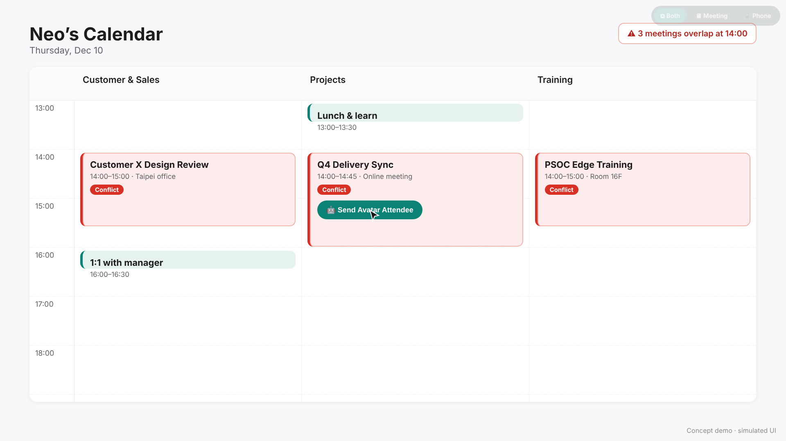
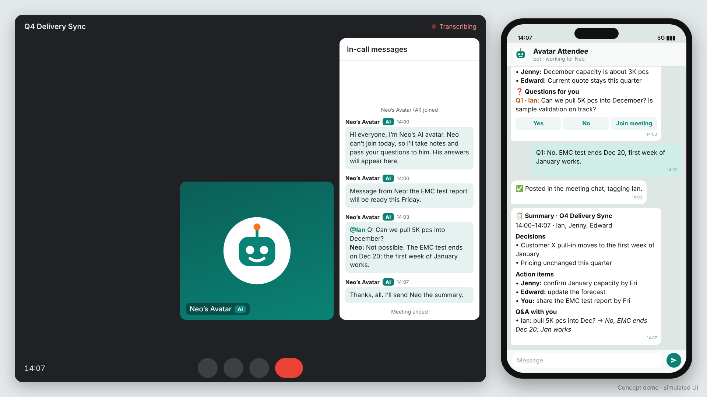

# Avatar Attendee — Demo Player

**Can’t attend? Stay in the loop.**
Avatar Attendee 是一個 AI agent 的概念 demo：你無法出席會議時，派出 AI 替身（Avatar）代為參加。Avatar 會在 chat 打招呼、每隔幾分鐘把重點和問題傳到你的手機，你回覆後它再把答案貼回會議 chat，會議結束後寄出總結。

> ⚠️ 這是 **concept demo（模擬 UI）**：所有畫面、台詞和訊息都是事先寫好的劇本，用來錄製展示影片，並沒有真的連上會議或 AI。

| Calendar | Meeting + Phone |
|---|---|
|  |  |

---

## 快速開始

1. 下載或 clone 這個 repo
2. 用 Chrome 直接開啟 `index.html`（雙擊就可以）
3. 按 **▶ Play (auto)** 自動播放，或按 **Step mode** 一步一步播

如果瀏覽器擋住了本機的音檔，就改用本機伺服器開啟：

```bash
python -m http.server 8000
# 再打開 http://localhost:8000
```

### 播放控制

| 按鍵 / 按鈕 | 功能 |
|---|---|
| `Space` | 暫停 / 繼續 |
| `→` | 下一步（Step mode） |
| `R` | 重新開始 |
| 右上角 **⧉ Both / 🖥 Meeting / 📱 Phone**，或 `1` `2` `3` | 切換：並排 / 只顯示會議 / 只顯示手機（滑鼠不動 2.5 秒後按鈕會自動隱藏） |
| `H` | 顯示 / 隱藏目前的步驟編號（除錯用） |

---

## 檔案結構

```
index.html            ← 畫面和播放引擎（通常不需要修改）
content/
  config.js           ← 名稱、會議標題、片尾文字、語音設定
  calendar.js         ← 第一幕：行事曆
  people.js           ← 與會者（名稱、職稱、顏色、聲音）
  script.js           ← 整段 demo 的流程：台詞、chat、手機訊息、摘要、總結
audio/                ← 語音檔：<id>.mp3
tools/
  generate_audio.py   ← 用 AI 語音批次產生 audio/*.mp3
docs/                 ← README 用的截圖
```

**要改內容，只需要改 `content/` 裡的檔案。** 存檔後重新整理瀏覽器就能看到結果。

---

## 編輯指南

### 1. 名稱、會議標題、片尾 — `content/config.js`

```js
OWNER: "Neo",                      // 不能出席的人
AVATAR_NAME: "Neo’s Avatar",       // Avatar 在會議畫面和 chat 中顯示的名稱
meetingTitle: "Q4 Delivery Sync",  // 會議視窗左上角的標題
startClock: "14:00",
botName: "Avatar Attendee",        // 手機聊天室的標題
botSubtitle: "bot · working for Neo",
watermark: "Concept demo · simulated UI",
endCard: { title: "...", subtitle: "...", footnote: "..." },  // 片尾畫面
```

### 2. 行事曆畫面 — `content/calendar.js`

- `title`、`date`、`banner`：左上角標題、日期，以及右上角的紅色衝突提示
- `columns`：三個欄位的標題
- `hours`：左側的時間刻度（每一列代表 1 小時）
- `sendLabel` / `sentLabel`：派出按鈕在點擊前、點擊後的文字
- `events`：每一個會議

```js
{ col: 2, start: 1.0, len: 0.75, title: "Q4 Delivery Sync", meta: "14:00–14:45 · Online meeting", conflict: true, send: true }
```

| 欄位 | 說明 |
|---|---|
| `col` | 放在第幾欄（1–3） |
| `start` | 從第一列往下算幾小時開始（`hours` 的第一個是 13:00，所以 `1.0` = 14:00、`1.5` = 14:30） |
| `len` | 長度，單位是小時 |
| `conflict` | `true` 時顯示紅色樣式和「Conflict」標籤 |
| `send` | `true` 時顯示「Send Avatar Attendee」按鈕（**只能有一個會議設成 true**，游標動畫會去點它） |

### 3. 與會者 — `content/people.js`

```js
Ian: { role: "CSM", color: "#8e44ad", browserVoice: 0, pitch: 1.0, rate: 1.0,
       tts: { edge: "en-US-GuyNeural", openai: "onyx" } },
```

- 物件的 key（`Ian`）就是 `script.js` 裡 `who` 要填的名字
- 會議畫面目前是 2×2 格：3 位與會者加上 Avatar。新增或刪除人的話，版面會跟著改變，建議維持 3 位
- `tts`：`tools/generate_audio.py` 產生語音時用的聲音（見第 5 節）

### 4. 會議流程與台詞 — `content/script.js`

`SCRIPT` 是一個陣列，**從上到下依序執行**。要改台詞，直接改 `text`；要加一句，就複製一行再修改；要調整順序，就搬動整行。

#### Step reference（所有可用的步驟）

| type | 用途 | 範例 |
|---|---|---|
| `wait` | 等待（毫秒） | `{ type: "wait", ms: 1500 }` |
| `cal_click` | 行事曆上的游標去點派出按鈕 | `{ type: "cal_click" }` |
| `toast` | 畫面下方的提示訊息 | `{ type: "toast", text: "Avatar is joining…", ms: 1800 }` |
| `scene` | 切換到會議畫面 | `{ type: "scene", to: "main" }` |
| `clock` | 更新會議和手機上的時鐘 | `{ type: "clock", t: "14:03" }` |
| `join` / `leave` | 與會者加入或離開（`who: "avatar"` 代表 Avatar） | `{ type: "join", who: "Ian" }` |
| `speak` | **某人說一句話**：該格亮起、出現字幕、播放語音 | `{ type: "speak", id: "04_ian", who: "Ian", text: "..." }` |
| `chat` | 會議 chat 訊息（`from: "avatar"` 會顯示 AI 標籤，也可以填人名） | `{ type: "chat", from: "avatar", text: "..." }` |
| `chat_sys` | chat 中置中的灰色系統訊息 | `{ type: "chat_sys", text: "Meeting ended" }` |
| `phone_typing` | 手機上 bot 顯示「輸入中…」 | `{ type: "phone_typing", ms: 1300 }` |
| `phone` | **bot 傳到手機的訊息**（支援 HTML 和按鈕） | 見下方 |
| `phone_tap` | 點擊最近一則訊息上的某個按鈕 | `{ type: "phone_tap", label: "No" }` |
| `phone_reply` | 「你」在手機上打字回覆（逐字打出） | `{ type: "phone_reply", text: "Q1: No..." }` |
| `skip` | 全螢幕的「時間快轉」轉場，可以同時更新時鐘 | `{ type: "skip", big: "⏩ Digest interval", small: "...", clock: "14:03" }` |
| `endcard` | 片尾畫面 | `{ type: "endcard" }` |

大多數步驟都可以加上 `ms`，指定這一步結束後要停多久。

#### `speak` 的規則
- `id` 必須是唯一值，同時也是語音檔名（`audio/04_ian.mp3`）。建議用「流水號_人名」，例如 `09_jenny`
- `who` 必須是 `people.js` 裡有的名字
- **每個 `speak` 都要寫在同一行**，`generate_audio.py` 才讀得到

### 5. 語音 — `audio/`

**規則：每個 `speak` 會播放 `audio/<id>.mp3`。檔案不存在時，自動改用瀏覽器內建語音**，所以缺了幾個檔案也能播放。

**方法 A：用 AI 語音自動產生（推薦）**

```bash
pip install edge-tts
python tools/generate_audio.py                  # 免費的 Microsoft 神經語音
python tools/generate_audio.py --provider openai   # 改用 OpenAI TTS（需要設定 OPENAI_API_KEY）
python tools/generate_audio.py --only 04_ian --force   # 只重新產生某一句
```

- 每個人用什麼聲音，在 `people.js` 的 `tts.edge` / `tts.openai` 設定
- edge-tts 可以用的聲音：`edge-tts --list-voices | grep en-`
- 改了台詞之後要加 `--force` 重新產生（已存在的檔案預設會跳過）

**方法 B：自己錄音**
把檔案依照 id 命名放進 `audio/`，例如 `audio/04_ian.mp3`。

> 播放的節奏由語音長度決定：每句話播完後，才會進到下一步。

### 6. 手機訊息：digest 與會後總結 — `content/script.js` 的 `phone` 步驟

```js
{ type: "phone", html:
`<h4>🕑 Digest · 14:00–14:03</h4><span class="sec">Key points</span>• <b>Ian:</b> Customer X wants to pull their order forward
• <b>Jenny:</b> December capacity is about 3K pcs
<span class="sec">❓ Questions for you</span><span class="q">Q1 · Ian:</span> Can we pull 5K pcs into December?`,
  buttons: ["Yes", "No", "Join meeting"] },
```

- 用反引號 `` ` `` 包起來，**換行就是真的換行**
- 可以用的格式：

| 寫法 | 效果 |
|---|---|
| `<h4>…</h4>` | 訊息標題（粗體） |
| `<span class="sec">…</span>` | 小節標題，例如 Key points、Decisions |
| `<span class="q">…</span>` | 問題編號（橘色） |
| `<b>…</b>` / `<i>…</i>` | 粗體 / 斜體 |
| `&amp;` | 顯示 `&` 符號 |

- `buttons`：訊息下方的按鈕（可以省略）。之後用 `phone_tap` 去點其中一個
- **會後總結**就是 `script.js` 最後那個 `phone` 步驟（📋 Summary），用同樣的方式編輯

### 7. 會議 chat 訊息

```js
{ type: "chat", from: "avatar", text: `<span class="mention">@Ian</span> Q: ...<br><b>${O}:</b> Not possible...` },
```

- `<span class="mention">@Ian</span>` 會顯示成 teal 色的 @ 標記
- `<br>` 是換行
- `${O}` 會自動換成 `config.js` 的 `OWNER`（要用反引號字串才有效）

### 8. 換一個會議主題：要改的地方

1. `config.js` → `meetingTitle`
2. `calendar.js` → 有 `send: true` 那個會議的 `title`、`meta`
3. `script.js` → `toast`，以及第一則 `phone`（「I’ve joined …」）裡的會議名稱
4. `script.js` → 所有 `speak` 台詞、`chat`、digest 和 summary 的內容
5. 重新產生語音：`python tools/generate_audio.py --force`

**小技巧：** 先寫好會議台詞，把它們當成逐字稿丟給 LLM（例如 GPT4IFX），請它依照「重點（標記講者）＋要問 Neo 的問題」的格式整理，再把結果貼回 digest 和 summary。這樣內容就是 AI 真的整理出來的。

---

## 錄影建議

- 用 Chrome 全螢幕（F11）開啟，OBS 設定 1920×1080，擷取視窗並勾選系統音訊
- 一鏡到底就用 **Play (auto)**；要分段重錄就用 **Step mode**
- 想把會議和手機分開錄，再切換 **🖥 Meeting / 📱 Phone** 錄兩次，後製時並排
- 錄影前先把滑鼠移到畫面外，讓右上角的按鈕自動隱藏

## （選用）用 GitHub Pages 線上播放

Settings → Pages → Source 選 `main` / root。之後就能在 `https://<username>.github.io/<repo>/` 播放（語音檔也會一起載入）。

---

全部內容都是虛構的（Customer X、5K pcs、EMC 12/20 等），與任何真實客戶或專案無關。
